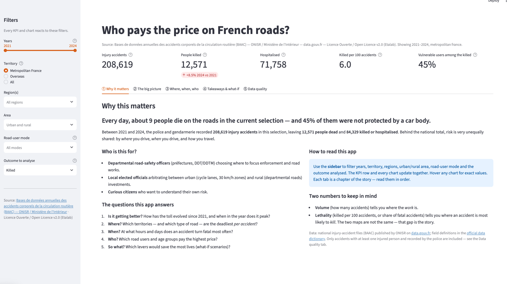
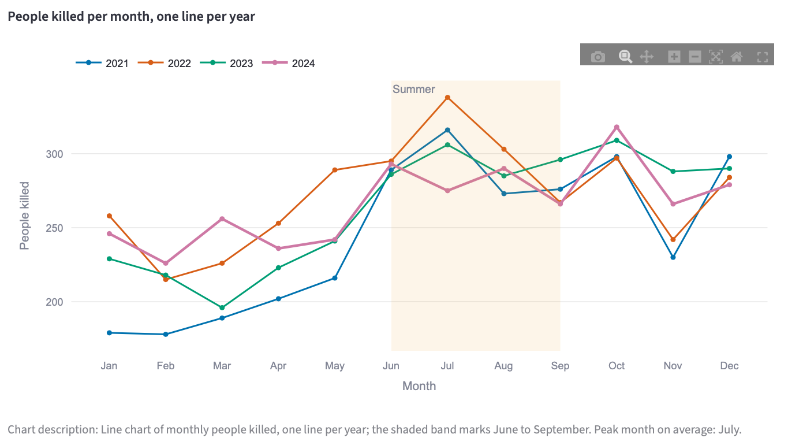
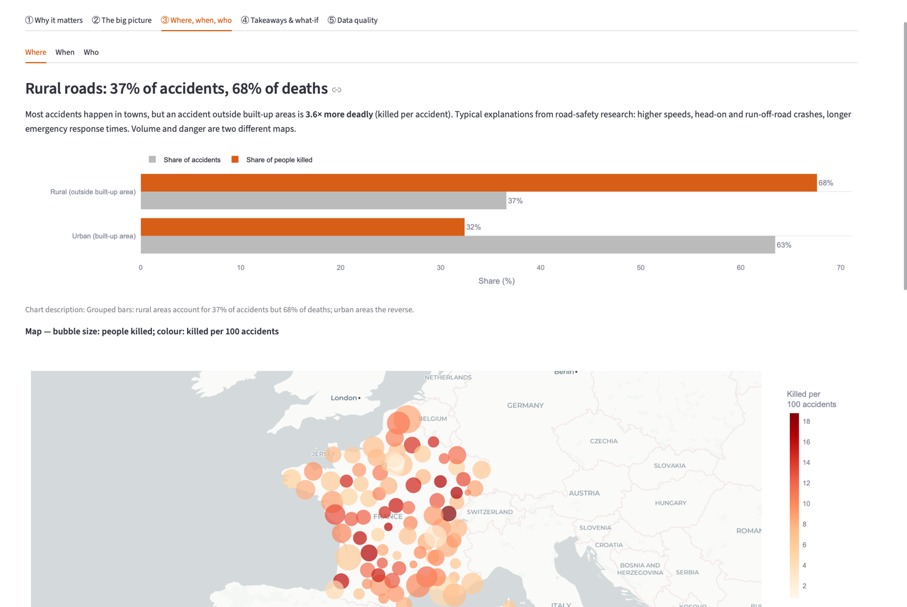
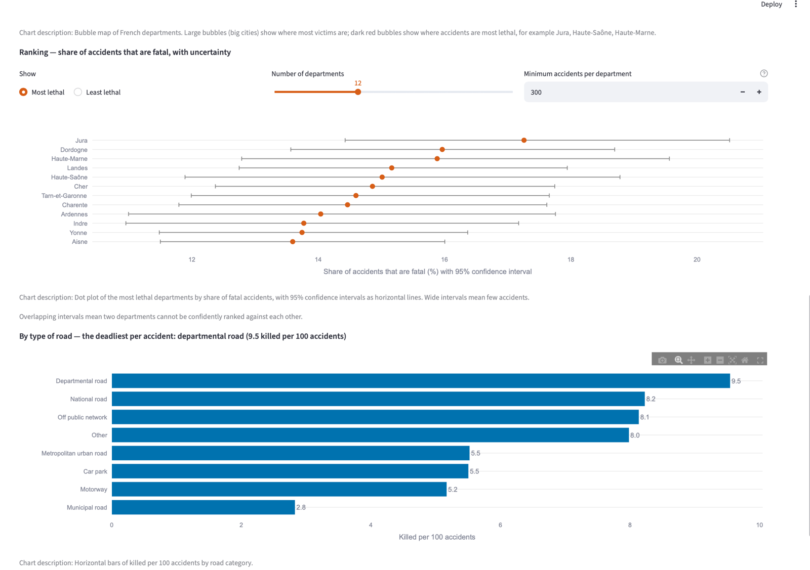
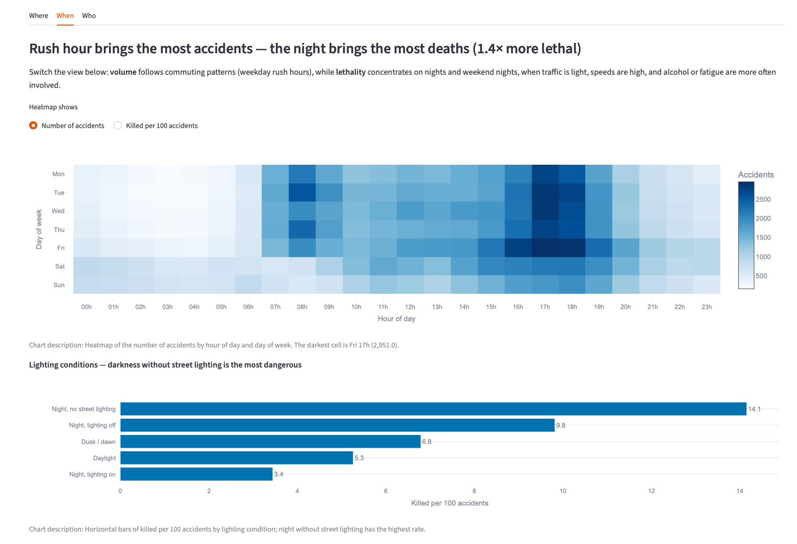
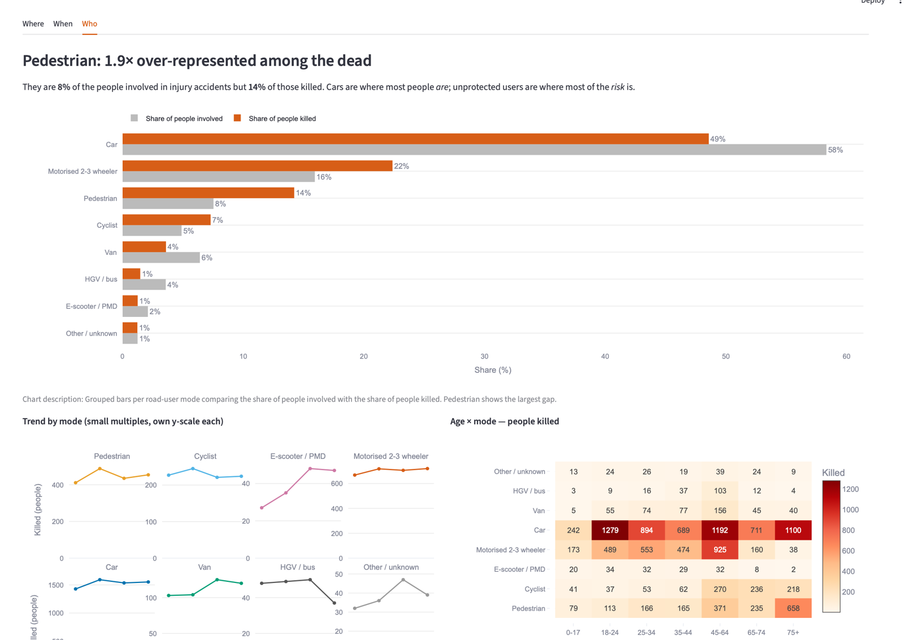
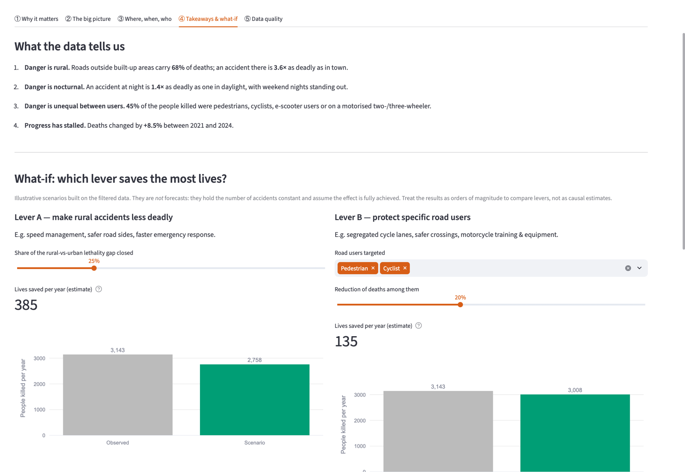
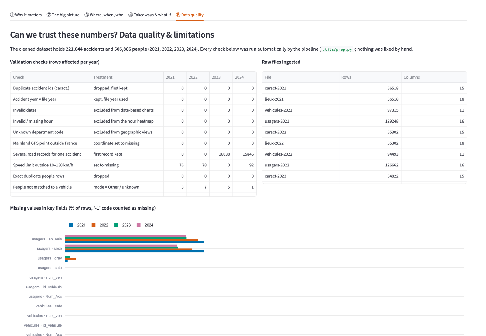

# 🛣️ Who pays the price on French roads?

**A data-storytelling dashboard built with Streamlit on France's official road-accident data (2021–2024).**

👩‍🎓 **Author:** Eya LAHOUEL · Student ID 20230413 · Cycle ingénieur BIA, EFREI Paris  
📊 **Dataset:** [BAAC – Bases de données annuelles des accidents corporels de la circulation routière](https://www.data.gouv.fr/datasets/53698f4ca3a729239d2036df/) (ONISR, data.gouv.fr) · Licence Ouverte v2.0  
🌐 **Live app:** _[add your Streamlit link here]_ · 🎬 **Demo video:** _[add the video link here]_



---

## 1. The story

Every day, about **9 people die** on the roads of metropolitan France, and **45% of them were not protected by a car body**.
But risk is not shared equally: it depends on **where** you drive, **when** you drive and **how** you travel.

> **Main message:** most accidents happen in towns, at rush hour, to car occupants — but most **deaths** happen on **rural roads**, **at night**, among **unprotected road users**. Volume and danger are two different maps.

| | |
|---|---|
| **Audience** | Departmental road-safety officers, local elected officials, curious citizens |
| **Questions** | Is it getting better? Where? When? Who? Which lever would save the most lives? |
| **Narrative** | Hook → Context → Key insights (where / when / who) → Implications (what-if) → Limits |
| **Patterns used** | Trend over time · regional comparison with a map · rankings with uncertainty · what-if scenarios |

---

## 2. Key findings

### 📈 The toll is not going down — and it peaks every summer
Deaths went from **2,944 in 2021 to 3,193 in 2024 (+8.5%)**. July is the deadliest month, February the calmest, and June–September account for **37%** of deaths.



### 🌾 Where: danger is rural
Rural roads carry **37% of accidents but 68% of deaths** — an accident outside a built-up area is **3.6× more deadly**. On the map, bubble size shows where victims are; colour shows how lethal accidents are.



The ranking shows the most lethal departments **with 95% confidence intervals**, so small departments are not over-interpreted. **Departmental roads** are the deadliest type of road (**9.5 deaths per 100 accidents**, vs 2.8 on municipal roads).



### 🌙 When: danger is nocturnal
Accidents peak at weekday rush hours (maximum: **Friday 5 pm**), but an accident **at night is 1.4× more deadly**, reaching **14 deaths per 100 accidents** at night without street lighting — almost 3× daylight.



### 🚶 Who: danger is unequal
Pedestrians are **8% of people involved but 14% of the dead** (1.9× over-represented); motorised two-wheelers **16% vs 22%**. Among pedestrians, people aged **75+** are hit hardest (658 killed).



### 🎚️ What-if: which lever saves the most lives?
Interactive simulators compare levers. Closing **25%** of the rural–urban lethality gap would save about **385 lives a year**; cutting pedestrian and cyclist deaths by 20% about **135**. Halving deaths by 2030 would require about **−7% per year**, while deaths currently rise by about **+3% per year**.



---

## 3. Data work

**Source:** 4 tables per year × 4 years (2021–2024), joined on the accident id (`Num_Acc`) and vehicle id (`id_vehicule`):

| Table | Content |
|---|---|
| `caract` | date, hour, department, lighting, weather, urban/rural, GPS |
| `lieux` | road category, speed limit |
| `vehicules` | vehicle category (→ road-user mode) |
| `usagers` | every person involved: role, injury severity, sex, birth year |

**Why 2021–2024?** These years share exactly the same schema, so comparisons are like-for-like (2020 is excluded because of the Covid lockdowns).

**Cleaning & validation** (automatic, results shown in the app):
- robust reading of each file (separator, encoding, quotes, column renamed in 2022)
- `-1` codes converted to missing values
- duplicates, invalid dates and hours, unknown departments
- GPS points outside mainland France, speed limits outside 10–130 km/h, ages outside 0–105
- people without a matching vehicle or accident

**Feature engineering:** road-user mode (pedestrian, cyclist, e-scooter, motorised 2-3 wheeler, car, van, HGV/bus), age groups, night flag, region, accident-level toll (killed / hospitalised / injured), lethality per department with **Wilson 95% confidence intervals**.

**Result:** **221,044 accidents** and **506,886 people** in the cleaned dataset.



---

## 4. Run the app

```bash
python3 -m venv .venv
source .venv/bin/activate          # Windows: .venv\Scripts\activate
pip install -r requirements.txt
python scripts/build_dataset.py    # downloads (once) + cleans the data -> data/processed/
streamlit run app.py
```

If `data/processed/` is already present, the build step can be skipped and the app starts instantly.

---

## 5. Project structure

```
app.py                    page setup, data loading (cached), sidebar filters, KPIs, chapters
sections/
  intro.py                ① Why it matters — hook, audience, questions
  overview.py             ② The big picture — yearly trend, seasonality
  deep_dives.py           ③ Where / When / Who — map, ranking, heatmap, road users
  conclusions.py          ④ Takeaways & what-if — insights, simulators, 2030 target
  quality.py              ⑤ Data quality — checks, missing values, limitations
utils/
  constants.py            data sources, code dictionaries, regions, colour palette
  io.py                   download with cache, robust CSV reader
  prep.py                 cleaning, validation, feature engineering
  viz.py                  chart functions (consistent style, tooltips, text descriptions)
scripts/build_dataset.py  one-command data pipeline
tests/                    automated tests on a synthetic sample
data/processed/           cleaned data (parquet) + quality report
photos/                   screenshots used in this README
```

**Engineering choices:** heavy processing done once and saved to parquet · `st.cache_data` on loading and filtering · modular code (one file per chapter) · pinned dependencies · automated tests.

**Design choices:** colour-blind-safe palette · labelled axes with units · hover tooltips · a text description under every chart · headlines computed from the data, so they stay true for any filter.

---

## 6. Limitations

- Only **injury accidents recorded by the police** are included; minor injuries are under-reported.
- "Killed" = died within 30 days; "hospitalised" is a less reliable indicator, so the story focuses on deaths.
- **No exposure data** (km travelled, population): over-representation among victims is not a risk per km.
- Patterns are **correlations, not causes** (night, rural roads and speed are linked).
- What-if scenarios are **illustrative orders of magnitude**, not forecasts.

---

## 7. Credits

Data © ONISR / Ministère de l'Intérieur — Licence Ouverte / Open Licence v2.0 (Etalab).  
Project by **Eya LAHOUEL** — EFREI Paris, 2026.
